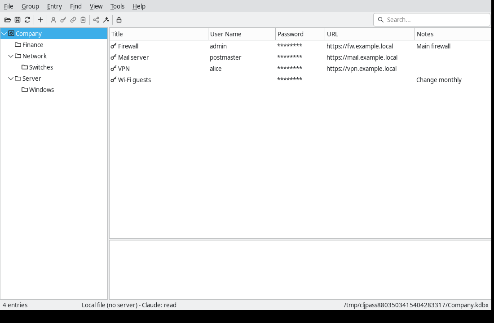
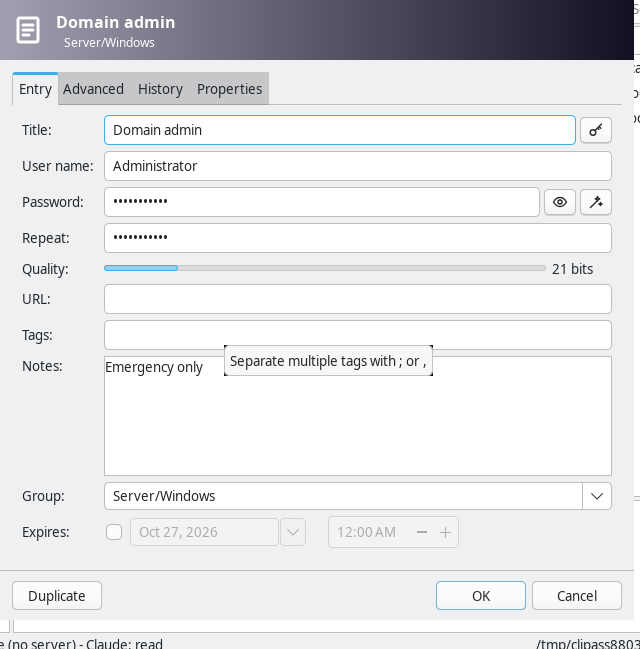
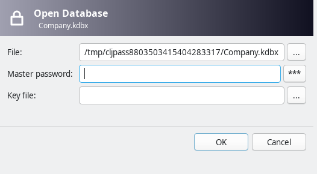
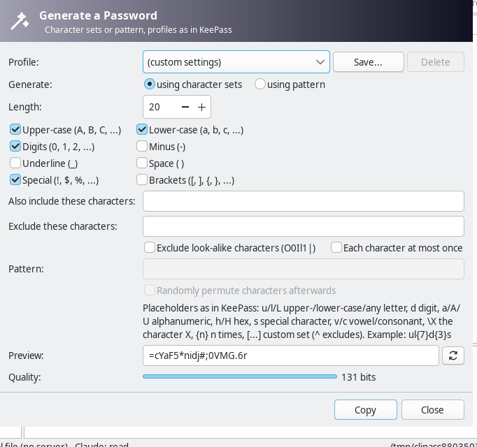
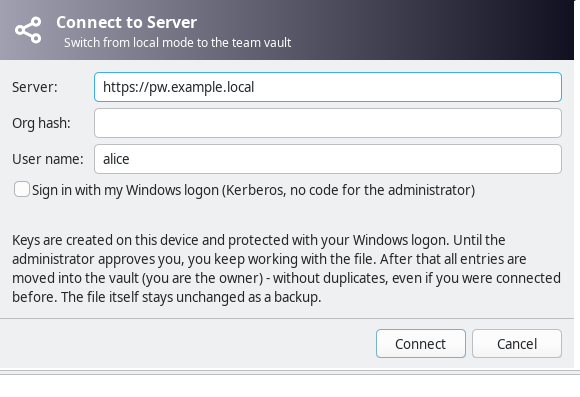

All of this readme and all of the code was created by LLMs - contact me directly if you have further questions.

# cljpass

A team password manager with **per-entry permissions** like Passbolt, an **offline-capable, file-like architecture** like KeePass and a **desktop UI like KeePass** (native controls via SWT). Written in Clojure and shipped with GraalVM native-image as a single binary (starts in ~10 ms, no Java needed). It works on a plain KeePass file or against an end-to-end encrypted team server, and you can switch between the two at any time. The UI is available in English and German.



## Features

- **End-to-end encrypted** (Ed25519, X25519, AES-256-GCM): the server sees no plaintext and holds no keys; admins manage membership but see no passwords.
- **Per-entry permissions** for users and groups (*can read*, *can edit*, *is owner*), enforced by encryption and signatures.
- **KeePass-compatible:** edit the same KDBX file in KeePass, KeePassXC and cljpass; import/export is lossless (attachments, history, plugin data, unknown elements).
- **Server optional:** switch file ↔ server and back without duplicates.
- **Offline:** reads come from a local cache, changes queue up, conflicts are never lost; a KeePass file on a share can be used through an offline copy.
- **Windows-friendly:** keys protected by DPAPI, optional single sign-on via Kerberos, users and groups synced from AD (the DC is not needed at runtime).
- **KeePass features:** TOTP, tags, attachments, history, groups and recycle bin, multiple databases in tabs with AutoOpen, password generator with patterns and profiles, CSV/XML/HTML/XSL export.
- **Password rotation at the target** via external plugins, approved by TOTP.
- **Controlled access for Claude** (or another LLM session) without revealing passwords, see below.

Feature-by-feature comparison with KeePass: [`doc/KEEPASS-PARITY.md`](doc/KEEPASS-PARITY.md). Formats, protocol and security model: [`doc/FORMAT.md`](doc/FORMAT.md).

## Install

- **Windows:** download the ZIP from *Releases* and put `cljpass.exe` (GUI) and `cljpass.com` (console) in one folder, e.g. `C:\Program Files\cljpass\`. For rollout via GPO, distribute `%ProgramData%\cljpass\org.edn` with server and org hash ([`windows/org.edn.example`](windows/org.edn.example)).
- **Linux (KDE Plasma, GNOME):** build (see *Development*), then run `linux/install.sh` (per user, no root; `--uninstall` removes it again). It installs the command, a start menu entry and the icon.
- **Server:** Docker ([`server/docker-compose.yml`](server/docker-compose.yml), with Caddy for TLS) or as a pod for Kubernetes/Podman ([`server/pod.yaml`](server/pod.yaml)).

## Quick start

### Local KeePass file (no server)

Start cljpass and choose **Local file**, or from the command line:

```sh
cljpass open Passwords.kdbx [--new]
```

The file stays a normal KDBX 4 file with master password and/or key file. *File > Synchronize with File...* merges with another copy as in KeePass.

### Team server

```sh
# 1. Server (set the init token only for the initial setup)
cljpass server --db /var/lib/cljpass/server.db --port 8080 --init-token SECRET

# 2. Create the vault (admin, once) - prints the org hash, the clients' trust anchor
cljpass init --server https://pw.example.local --org "Example Ltd" --init-token SECRET --recovery-out recovery.json

# 3. Each user: File > Connect to Server... shows a fingerprint; the admin approves it
cljpass requests
cljpass approve alice --fingerprint b53f-4147-... --display-name "Alice Berger"

# 4. Groups, directly or from AD groups pw-*
cljpass group it alice bob carol
cljpass ad-sync --prefix pw-
```

Keep `recovery.json` offline and remove the init token from the server afterwards. Kerberos single sign-on, automatic approval and the audit log are described in [`doc/FORMAT.md`](doc/FORMAT.md); `cljpass help` lists all commands, including device transfer and recovery.

## Access for Claude

A Claude session can work with the unlocked vault through `cljpass agent` (`cljpass agent help`): find and show entries, edit them, generate passwords, open SSH channels and trigger password rotation.

- Read access is a setting in *Tools*. Writing needs the separate switch *Tools > Claude may write*, which turns off again on every lock.
- The session never sees passwords, protected fields or TOTP codes; generated and rotated passwords stay inside cljpass.
- Entries tagged `human-only` are off limits.
- SSH channels and rotations need the human's approval in a dialog; a rotation on an entry with TOTP also needs a one-time code that only the human has.
- Everything the session does is logged.

## Development

Requirements: JDK 21 and the [Clojure CLI](https://clojure.org/guides/install_clojure); for the native binary also [GraalVM](https://www.graalvm.org/downloads/) with `native-image`.

```sh
clojure -M:test                          # all tests incl. end-to-end with a real server
clojure -M:swt-linux:run                 # start the UI (:swt-win / :swt-mac per platform)
clojure -T:build uber                    # target/cljpass.jar
clojure -T:build native                  # target/cljpass(.exe/.com), standalone
```

Windows build: `powershell -ExecutionPolicy Bypass -File windows\build.ps1`. CI builds and smoke-tests the binary on Windows, macOS and Linux; a tag `v*` publishes a Windows release.

| | |
|---|---|
|  |  |
|  |  |

## License

cljpass is free software under the **GNU Affero General Public License v3 or later** ([`LICENSE`](LICENSE)), with an additional permission for combining it with the EPL-licensed Clojure and SWT ([`NOTICE`](NOTICE)).

The UI follows the layout of KeePass 2.x (GPL-2.0-or-later). No KeePass code or artwork is included.
